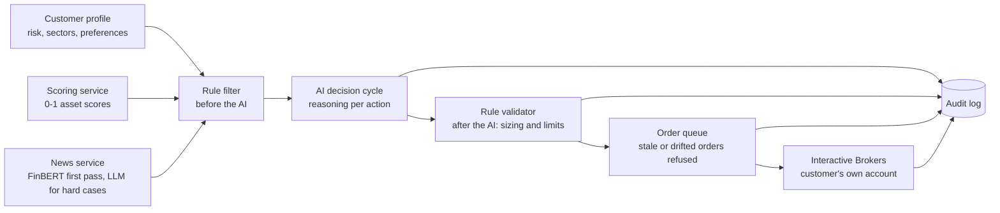

# Coincruze: overview

Coincruze is an AI portfolio manager. A customer sets a strategy once. Every market day the system scores the eligible assets, reads financial news and runs an AI decision cycle. Rules that the AI cannot override then check and size every order, and orders go to the customer's own Interactive Brokers account. Every decision, including a decision to do nothing, is stored with plain-English reasons.

**This repository contains documentation only. The source code is private.**

> **Status (read this first).** Coincruze is pre-launch. It runs end to end in paper trading on ten simulated test accounts. It has no customers, no revenue and no real-money trading. The strategy has not been validated. Coincruze is not a registered investment adviser and nothing here is investment advice or an offer of advisory services.

## Where it stands

| Item | State |
|---|---|
| Four services running together in paper trading | Built |
| Daily chain (scoring, news, decision cycle, order queue) | Runs unattended |
| First full market open, 15 Sep 2026 | 13 of 14 queued orders filled; the 14th was rejected because the system could not reach the broker |
| All paper trading to 2 Oct 2026 | 59 orders on 10 test accounts: 40 filled, 9 cancelled by the system's own 24-hour stale-order rule, 10 rejected (mostly broker connection failures and a euro-denominated account) |
| Decision audit log | Every cycle writes a record with inputs, model, reasoning and outcome |
| Real customers, revenue, real-money trading | None |
| Strategy performance | Not validated; paper results are not evidence of returns |

*Order figures are as of 2-4 Oct 2026, counted from the production database. They are a snapshot, not a live count.*

## How one decision is made

1. **Assemble inputs:** the live portfolio, the customer's profile, scored candidates and recent news signals.
2. **Rule filter before the AI:** limits such as sector caps and a drawdown breaker are checked first.
3. **AI reasoning:** the model proposes buy, hold, sell, trim or wait with a written reason per action.
4. **Rule check after the AI:** deterministic code sizes each order and enforces position limits. The model cannot argue its way past them.
5. **Queue and submit:** orders wait overnight and are submitted after the open. Stale or price-drifted orders are refused, and the reason is recorded.
6. **Audit row, always:** every cycle is recorded, including failures and refusals.

See [ARCHITECTURE.md](ARCHITECTURE.md) and [DECISION-RECORD-EXAMPLE.md](DECISION-RECORD-EXAMPLE.md).

## Design principles

- **Rules beat opinions.** The customer's limits are enforced in code outside the AI.
- **Fail loudly.** A failed cycle is recorded with its reason, never silently skipped.
- **Never show a number the system hasn't earned.** No simulated performance anywhere in the product.

## Known limits

- The strategy has not been validated, and the AI layer cannot be honestly backtested. It has to be tested forward, against a simple baseline.
- Paper trading only. Real-money use depends on adviser registration, a broker partner agreement and commercial data licences, none of which is complete.
- One production host and one broker gateway. Per-position stop loss is designed, not built.

A longer list is in [STATUS.md](STATUS.md).

## Author

Matus Labaj, Prague. [LinkedIn](https://www.linkedin.com/in/matus-labaj) · matus@coincruze.com

*All rights reserved. This repository documents a private project; no source code or license to use the software is granted.*
